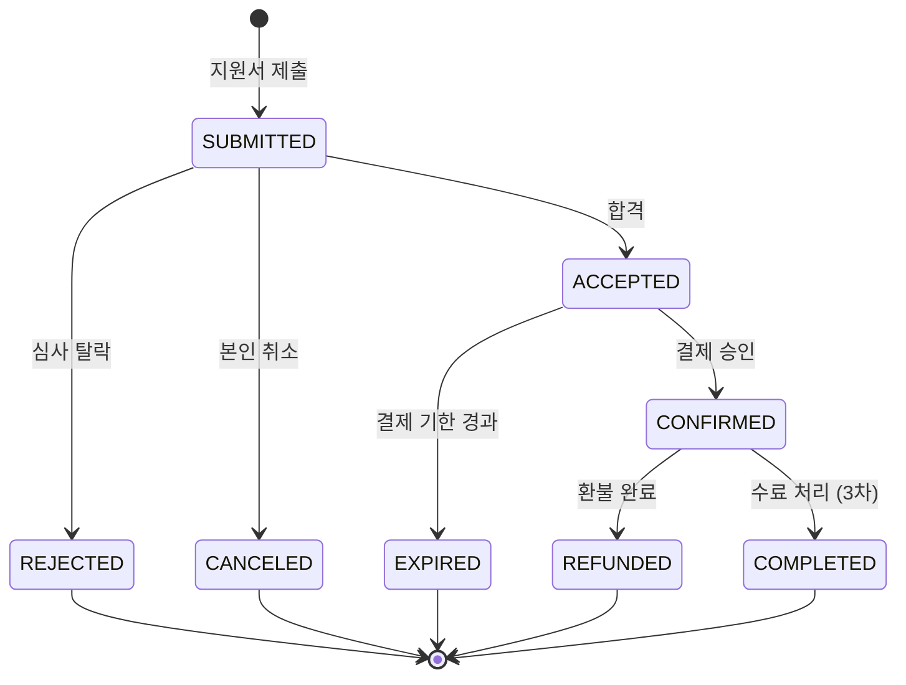
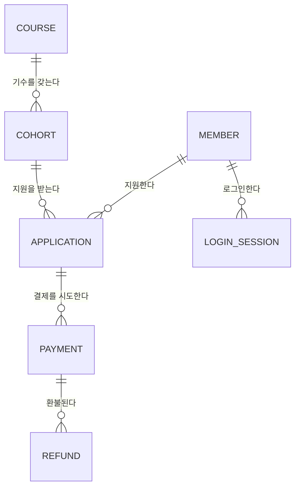

# 요구사항 명세서: 부트캠프 교육 커머스 플랫폼

- 문서 버전: v0.1
- 작성일: 2026-11-24
- 위치: `docs/REQUIREMENTS.md`

> 단계 표기: **[1차]** MVP, **[2차]** 커머스·마케팅 요소, **[3차]** 여유가 있을 때

---

## 1. 개요

### 1.1 목적

한 교육사가 운영하는 여러 부트캠프 과정을 소개하고, 지원부터 선발, 결제, 수강 확정, 환불까지 한 사이트에서 처리한다.

### 1.2 범위

- 포함: 과정·기수 소개, 회원, 지원·심사, 결제(PG 테스트 모드), 환불, 관리자 기능
- 제외: 강의 영상 스트리밍, 실제 국비지원(내일배움카드) 시스템 연동, 여러 교육사 입점

### 1.3 용어

| 용어 | 설명 |
| --- | --- |
| 과정(Course) | 백엔드 자바 스프링, 프론트엔드, UI/UX 디자인, PM 등 상품의 정체성 |
| 기수(Cohort) | "백엔드 12기"처럼 실제로 모집·판매되는 단위. 기간, 정원, 가격을 가진다 |
| 지원서(Application) | 회원이 특정 기수에 지원한 기록. 주문 역할을 한다 |
| 선점 | 결제를 시작할 때 자리를 임시로 확보하는 것. 10분 유지 |
| 폐강 | 모집 마감 시 최소 인원에 미달해 기수가 취소되는 것 |

---

## 2. 사용자와 역할

| 역할 | 설명 | 권한 |
| --- | --- | --- |
| 비회원 | 과정 탐색, 사전 알림·설명회 신청(2차) | 없음 |
| 회원 | 지원, 결제, 환불, 마이페이지 | `USER` (`member.role`) |
| 관리자 | 과정·기수 관리, 심사, 결제·환불 관리 | `ADMIN` (`member.role`) |

수강생은 별도 권한이 아니라 "결제 완료된 지원서를 가진 회원"이다.

---

## 3. 기능 요구사항

### 3.1 회원 (MEM)

| ID | 단계 | 요구사항 |
| --- | --- | --- |
| FR-MEM-01 | 1차 | 이메일, 비밀번호, 이름, 연락처로 회원가입한다. 이메일은 중복될 수 없다 |
| FR-MEM-02 | 1차 | 비밀번호는 BCrypt로 암호화해 저장한다 |
| FR-MEM-03 | 1차 | 이메일과 비밀번호로 로그인·로그아웃한다 |
| FR-MEM-04 | 1차 | 이름과 연락처를 수정할 수 있다 |

### 3.2 과정·기수 조회 (CRS)

| ID | 단계 | 요구사항 |
| --- | --- | --- |
| FR-CRS-01 | 1차 | 공개된 과정 목록을 조회한다. 분야(BACKEND, FRONTEND, DESIGN, PM)로 필터링한다 |
| FR-CRS-02 | 1차 | 과정 카드에 모집 중인 기수의 기간, 가격, 모집 상태를 표시한다 |
| FR-CRS-03 | 1차 | 과정 상세에서 소개, 커리큘럼, 지원 대상, FAQ, 기수 목록(일정, 가격, 남은 자리)을 보여준다 |
| FR-CRS-04 | 1차 | 모집 중(RECRUITING)인 기수에만 지원 버튼이 활성화된다 |

### 3.3 지원 (APP)

| ID | 단계 | 요구사항 |
| --- | --- | --- |
| FR-APP-01 | 1차 | 로그인한 회원은 모집 중인 기수에 지원서를 제출한다 |
| FR-APP-02 | 1차 | 같은 회원은 같은 기수에 한 번만 지원할 수 있다 |
| FR-APP-03 | 1차 | 심사 전(SUBMITTED)인 지원서만 본인이 취소할 수 있다 |
| FR-APP-04 | 1차 | 마이페이지에서 지원서별 상태와 결제 기한을 확인한다 |
| FR-APP-05 | 1차 | 지원서 상태는 5장의 상태 머신을 따른다. 허용되지 않은 전이는 거부한다 |

### 3.4 심사 (REV)

| ID | 단계 | 요구사항 |
| --- | --- | --- |
| FR-REV-01 | 1차 | 관리자는 기수별 지원자 목록을 상태별로 조회한다 |
| FR-REV-02 | 1차 | 관리자는 지원서를 합격(ACCEPTED) 또는 불합격(REJECTED) 처리한다 |
| FR-REV-03 | 1차 | 합격 시 결제 기한(`payment_due_at`, 기본 72시간)을 설정하고 안내 메일을 보낸다 |
| FR-REV-04 | 1차 | 합격자 수는 정원을 넘을 수 있다(예비 합격). 자리는 결제 시점에 선점한다 |

### 3.5 결제 (PAY)

| ID | 단계 | 요구사항 |
| --- | --- | --- |
| FR-PAY-01 | 1차 | 합격(ACCEPTED) 상태이고 결제 기한 내인 지원서만 결제할 수 있다 |
| FR-PAY-02 | 1차 | 결제 준비 시 서버가 `order_id`와 금액을 생성해 저장(READY)하고 자리를 선점한다 |
| FR-PAY-03 | 1차 | 남은 자리가 없으면 `COHORT_FULL` 오류를 반환한다. 지원서는 ACCEPTED로 남는다 |
| FR-PAY-04 | 1차 | 결제 승인 요청 시 서버가 저장된 금액과 요청 금액을 대조한 뒤 PG 승인 API를 호출한다 |
| FR-PAY-05 | 1차 | 승인 성공 시 결제는 DONE, 지원서는 CONFIRMED가 되고 안내 메일을 보낸다 |
| FR-PAY-06 | 1차 | 같은 `order_id`에 대한 중복 승인 요청은 한 번만 처리한다 |
| FR-PAY-07 | 1차 | PG 승인 후 DB 처리에 실패하면 PG 결제를 취소한다 |
| FR-PAY-08 | 1차 | 선점 후 10분 안에 승인되지 않은 결제는 자리를 반환한다 |
| FR-PAY-09 | 1차 | 결제 기한이 지난 ACCEPTED 지원서는 EXPIRED로 바꾼다 |

### 3.6 환불 (RFD)

| ID | 단계 | 요구사항 |
| --- | --- | --- |
| FR-RFD-01 | 1차 | CONFIRMED 지원서의 회원은 환불을 요청할 수 있다 |
| FR-RFD-02 | 1차 | 환불액은 6장의 환불 정책에 따라 계산한다 |
| FR-RFD-03 | 1차 | PG 취소 API로 전액 또는 부분 환불하고, 결제 상태를 CANCELED 또는 PARTIAL_CANCELED로 바꾼다 |
| FR-RFD-04 | 1차 | 환불 완료 시 지원서는 REFUNDED가 되고 자리를 반환한다 |
| FR-RFD-05 | 2차 | 환불 실패 건은 FAILED로 기록하고 최대 3회 재시도한다. 계속 실패하면 관리자 화면에 표시한다 |

### 3.7 관리자 (ADM)

| ID | 단계 | 요구사항 |
| --- | --- | --- |
| FR-ADM-01 | 1차 | 과정을 등록·수정·비공개 처리한다 |
| FR-ADM-02 | 1차 | 기수를 등록·수정한다(모집 기간, 교육 기간, 정원, 최소 인원, 가격, 국비/자비) |
| FR-ADM-03 | 1차 | 기수 상태를 변경한다(SCHEDULED → RECRUITING → CLOSED → IN_PROGRESS → FINISHED) |
| FR-ADM-04 | 1차 | 대시보드에서 모집 중 기수, 심사 대기 수, 결제 대기 수를 본다 |
| FR-ADM-05 | 1차 | 기수별 결제·환불 내역을 조회한다 |

### 3.8 알림 (NTF)

| ID | 단계 | 요구사항 |
| --- | --- | --- |
| FR-NTF-01 | 1차 | 합격, 불합격, 결제 완료, 결제 기한 24시간 전, 환불 완료 시 이메일을 보낸다 |
| FR-NTF-02 | 2차 | 모집 오픈 사전 알림 신청자에게 오픈 시 일괄 발송한다. 같은 사람에게 중복 발송하지 않는다 |

### 3.9 2차 기능

| ID | 요구사항 |
| --- | --- |
| FR-EXT-01 | 설명회 회차를 등록하고, 회원·비회원이 정원 내에서 예약·취소한다 |
| FR-EXT-02 | 기수별로 기간에 따른 가격(얼리버드 등)을 설정하면 결제 시점 가격이 자동 적용된다 |
| FR-EXT-03 | 정액·정률 쿠폰을 발행하고 1인 1회 사용한다. 결제 취소 시 쿠폰을 복원한다 |
| FR-EXT-04 | 모집 마감 시각 이후 확정 인원이 최소 인원 미만인 기수를 폐강(CANCELED)하고 전원 전액 환불한다 |
| FR-EXT-05 | 정원 선점을 Redis 기반으로 구현하고 k6로 DB 방식과 정확성·응답 시간을 비교한다 |

### 3.10 3차 기능

- 출결 기록과 수료 처리(CONFIRMED → COMPLETED), 수료증 PDF 발급
- 유입 경로(UTM) 저장과 과정별 전환율 대시보드
- 국비지원 자부담금 계산(모의), 분할결제
- 강사·매니저 역할 추가

---

## 4. 비기능 요구사항

| ID | 분류 | 요구사항 |
| --- | --- | --- |
| NFR-01 | 정합성 | 동시 결제 요청 500건, 정원 30명 조건에서 확정 인원이 정원을 넘지 않는다 |
| NFR-02 | 보안 | 비밀번호는 BCrypt로 해시해 저장, 로그인은 세션(HttpOnly 쿠키) 방식, 관리자 API는 `ADMIN` 역할만 접근한다 |
| NFR-03 | 보안 | PG 시크릿 키, DB 비밀번호 등은 환경 변수로 관리하고 저장소에 올리지 않는다 |
| NFR-04 | 신뢰성 | 결제 금액은 항상 서버에 저장된 값을 기준으로 검증한다 |
| NFR-05 | 일관성 | 금액은 원 단위 정수, 시간은 Asia/Seoul 기준으로 통일한다 |
| NFR-06 | 운영 | main 브랜치에 병합하면 GitHub Actions로 자동 빌드·배포된다 |
| NFR-07 | 문서화 | API 명세(요청·응답 예시 포함)는 `docs/api.md`에 직접 작성해 관리한다 |
| NFR-08 | 테스트 | 상태 전이, 환불 정책, 정원 동시성은 자동화 테스트로 검증한다 |
| NFR-09 | 데이터 | DB는 MySQL 8을 쓰고, 스키마 변경은 버전 관리되는 마이그레이션(Flyway)으로만 한다 |
| NFR-10 | 테스트 | DB가 필요한 테스트는 운영과 같은 MySQL(Testcontainers)에서 실행한다 |

---

## 5. 지원서 상태 머신

| 상태 | 한글 | 설명 |
| --- | --- | --- |
| SUBMITTED | 심사중 | 지원서 제출 직후 |
| ACCEPTED | 합격·결제대기 | 결제 기한 안에 결제해야 한다 |
| CONFIRMED | 수강 확정 | 결제 승인 완료 |
| COMPLETED | 수료 | 3차 |
| CANCELED | 지원 취소 | 종료 상태 |
| REJECTED | 불합격 | 종료 상태 |
| EXPIRED | 기한 만료 | 종료 상태 |
| REFUNDED | 환불 완료 | 종료 상태 |

### 기수 상태

| 상태 | 설명 |
| --- | --- |
| SCHEDULED | 등록됨, 모집 전 |
| RECRUITING | 모집 중 |
| CLOSED | 모집 마감 |
| IN_PROGRESS | 교육 진행 중 |
| FINISHED | 교육 종료 |
| CANCELED | 폐강 |

---

## 6. 환불 정책

학원법 시행령의 교습비 반환 기준을 참고한 예시다. **구현 전에 법령 원문을 확인한다.**

| 환불 요청 시점 | 환불액 |
| --- | --- |
| 개강 전 | 결제액 전액 |
| 개강 후 총 교육기간의 1/3 경과 전 | 결제액의 2/3 |
| 1/3 경과 후 1/2 경과 전 | 결제액의 1/2 |
| 1/2 경과 후 | 환불 없음 |
| 폐강 | 결제액 전액 |

---

## 7. 화면 목록

| ID | 화면 | 경로 | 단계 |
| --- | --- | --- | --- |
| U-01 | 메인 | `/` | 1차 |
| U-02 | 과정 목록 | `/courses` | 1차 |
| U-03 | 과정 상세(랜딩) | `/courses/{id}` | 1차 |
| U-04 | 로그인·회원가입 | `/login`, `/signup` | 1차 |
| U-05 | 지원서 작성 | `/cohorts/{id}/apply` | 1차 |
| U-06 | 지원 완료 | `/applications/{id}/done` | 1차 |
| U-07 | 마이페이지 | `/my` | 1차 |
| U-08 | 결제 | `/applications/{id}/pay` | 1차 |
| U-09 | 결제 결과 | `/payments/success`, `/payments/fail` | 1차 |
| U-10 | 설명회 예약 | `/sessions` | 2차 |
| A-01 | 관리자 대시보드 | `/admin` | 1차 |
| A-02 | 과정 관리 | `/admin/courses` | 1차 |
| A-03 | 기수 관리 | `/admin/cohorts` | 1차 |
| A-04 | 지원자 심사 | `/admin/cohorts/{id}/applications` | 1차 |
| A-05 | 결제·환불 관리 | `/admin/payments` | 1차 |
| A-06 | 쿠폰 관리 | `/admin/coupons` | 2차 |

---

## 8. 데이터 모델

DB 구성, 테이블 작성 규칙(네이밍·타입·제약 이름), 마이그레이션 방법은 `docs/db-design.md`를 따른다.
**컬럼 타입·NULL·인덱스·CHECK 등 상세 ERD는 `docs/erd.md`가 기준이다.** 아래는 요약이다.

### 8.1 1차 테이블

모든 테이블에 `created_at`, `updated_at`이 있다.

| 테이블 | 주요 컬럼 | 제약·메모 |
| --- | --- | --- |
| `member` | id, email, password_hash, name, phone, role | email UK |
| `course` | id, title, category, summary, description, curriculum, target_audience, faq, thumbnail_url, is_public | category: BACKEND / FRONTEND / DESIGN / PM |
| `cohort` | id, course_id, generation, recruit_start_at, recruit_end_at, start_date, end_date, capacity, min_capacity, reserved_count, price, funding_type, status | (course_id, generation) UK |
| `application` | id, member_id, cohort_id, status, answers(JSON), payment_due_at, payment_reminder_sent_at, reviewed_at | (member_id, cohort_id) UK. 지원 시각은 created_at |
| `payment` | id, application_id, order_id, payment_key, amount, method, status, reserved_until, approved_at, fail_reason | application 1:N (시도마다 새 행), order_id UK. status: READY / DONE / PARTIAL_CANCELED / CANCELED / FAILED / EXPIRED |
| `refund` | id, payment_id, amount, reason, status, retry_count, refunded_at | payment 1:N. 요청 시각은 created_at |
| `login_session` | id, member_id, token_hash, expires_at | token_hash UK. 세션 방식 로그인용 |

### 8.2 2차 테이블

| 테이블 | 주요 컬럼 |
| --- | --- |
| `coupon` | id, code(UK), discount_type, discount_value, valid_from, valid_until, total_quantity |
| `member_coupon` | id, member_id, coupon_id, used_at, payment_id |
| `price_policy` | id, cohort_id, name, price, start_at, end_at |
| `info_session` | id, course_id, held_at, capacity, reserved_count |
| `session_reservation` | id, info_session_id, member_id 또는 email, status |
| `open_alert` | id, cohort_id, email, notified_at |

---

## 9. API 목록 (1차)

| 메서드 | 경로 | 설명 | 권한 | 관련 요구사항 |
| --- | --- | --- | --- | --- |
| POST | `/api/auth/signup` | 회원가입 | 비회원 | FR-MEM-01 |
| POST | `/api/auth/login` | 로그인 (세션 쿠키 발급) | 비회원 | FR-MEM-03 |
| POST | `/api/auth/logout` | 로그아웃 (세션 삭제) | USER | FR-MEM-03 |
| GET | `/api/me` | 내 정보 조회 (프론트의 로그인 상태 확인용) | USER | FR-MEM-03 |
| PATCH | `/api/me` | 내 정보 수정 | USER | FR-MEM-04 |
| GET | `/api/courses?category=` | 과정 목록 | 모두 | FR-CRS-01 |
| GET | `/api/courses/{courseId}` | 과정 상세 + 기수 목록 | 모두 | FR-CRS-03 |
| POST | `/api/cohorts/{cohortId}/applications` | 지원서 제출 | USER | FR-APP-01 |
| GET | `/api/me/applications` | 내 지원 현황 | USER | FR-APP-04 |
| DELETE | `/api/applications/{applicationId}` | 지원 취소 | USER | FR-APP-03 |
| POST | `/api/applications/{applicationId}/payments` | 결제 준비(선점) | USER | FR-PAY-02 |
| POST | `/api/payments/confirm` | 결제 승인 | USER | FR-PAY-04 |
| POST | `/api/payments/{paymentId}/refunds` | 환불 요청 | USER | FR-RFD-01 |
| GET | `/api/me/payments` | 결제·환불 내역 | USER | FR-APP-04 |
| POST, PUT | `/api/admin/courses`, `/api/admin/courses/{id}` | 과정 등록·수정 | ADMIN | FR-ADM-01 |
| POST, PUT | `/api/admin/cohorts`, `/api/admin/cohorts/{id}` | 기수 등록·수정 | ADMIN | FR-ADM-02 |
| PATCH | `/api/admin/cohorts/{id}/status` | 기수 상태 변경 | ADMIN | FR-ADM-03 |
| GET | `/api/admin/cohorts/{id}/applications?status=` | 지원자 목록 | ADMIN | FR-REV-01 |
| PATCH | `/api/admin/applications/{id}/review` | 합격·불합격 | ADMIN | FR-REV-02 |
| GET | `/api/admin/dashboard` | 대시보드 요약 | ADMIN | FR-ADM-04 |
| GET | `/api/admin/payments?cohortId=` | 결제·환불 현황 | ADMIN | FR-ADM-05 |

### 9.1 공통 에러 코드 (초안)

| 코드 | HTTP | 설명 |
| --- | --- | --- |
| `INVALID_INPUT` | 400 | 요청 값 형식·필수값 오류 |
| `UNAUTHORIZED` | 401 | 로그인 필요 (세션 없음·만료) |
| `LOGIN_FAILED` | 401 | 이메일 또는 비밀번호 불일치 |
| `FORBIDDEN` | 403 | 권한 없음 (관리자 API 등) |
| `NOT_FOUND` | 404 | 대상 없음 |
| `INTERNAL_ERROR` | 500 | 서버 내부 오류 (상세 내용은 로그에만 남긴다) |
| `DUPLICATE_EMAIL` | 409 | 이미 가입된 이메일 |
| `COHORT_NOT_RECRUITING` | 400 | 모집 중이 아닌 기수 |
| `DUPLICATE_APPLICATION` | 409 | 같은 기수에 이미 지원 |
| `INVALID_APPLICATION_STATUS` | 400 | 허용되지 않은 상태 전이 |
| `PAYMENT_DEADLINE_PASSED` | 400 | 결제 기한 경과 |
| `COHORT_FULL` | 409 | 남은 자리 없음 |
| `PAYMENT_AMOUNT_MISMATCH` | 400 | 결제 금액 불일치 |
| `PAYMENT_ALREADY_PROCESSED` | 409 | 이미 처리된 결제 |
| `REFUND_NOT_ALLOWED` | 400 | 환불 불가 시점 |

---

## 10. 마일스톤

| 단계 | 내용 | 완료 기준 |
| --- | --- | --- |
| M0 | 기획과 시안: 화면 설계서, Stitch 시안, ERD 확정, 저장소·이슈 보드 | 1차 범위 확정 |
| M1 | 뼈대와 배포: 프로젝트 생성, 회원가입·로그인, Docker + GitHub Actions | 배포 주소에서 로그인 동작 |
| M2 | 과정과 기수: 관리자 등록, 메인·목록·상세 화면 | 등록한 기수가 상세 페이지에 노출 |
| M3 | 지원과 심사: 지원·취소, 상태 머신, 심사 화면, 마이페이지 | 지원 → 합격이 화면에서 진행 |
| M4 | 결제와 환불: PG 연동, 금액 검증, 정원 선점, 스케줄러, 환불, 메일 | 지원부터 환불까지 배포 환경에서 동작 |
| M5~ | 2차 기능: 폐강 배치 → Redis·k6 비교 → 쿠폰·얼리버드 → 사전 알림 → 설명회 | 기능별로 README에 기술 결정 기록 |

---

## 11. 미결정 사항

- [ ] 정원 선점 시점: 결제 시작 시(현재 가안) vs 합격 시
- [x] 인증 방식: 세션 + DB 저장으로 결정 (2026-11-24, `docs/backend-design.md` 3장)
- [ ] 결제 기한 기본값(72시간)과 선점 유지 시간(10분) 확정
- [ ] 배포 환경: AWS vs 저비용 PaaS
