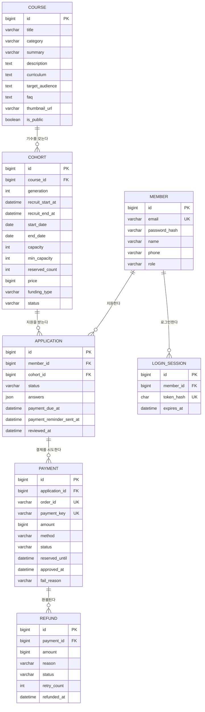

# ERD

부트캠프 교육 커머스 플랫폼의 테이블 설계다.

- 1차 확정: 2026-11-24
- 테이블 작성 규칙(네이밍, 타입, 공통 컬럼, 제약 이름)과 결제·정원 처리 규칙은 [`db-design.md`](db-design.md)를 따른다.
- 이 문서를 바꾸면 `db/migration/`에 새 마이그레이션 파일을 추가하고, `REQUIREMENTS.md` 8장 요약도 함께 고친다.

## 1. 1차 ERD

다이어그램에서는 공통 컬럼(`created_at`, `updated_at`)을 생략했다.

### 1.1 member (회원)

| 컬럼 | 타입 | NULL | 설명 |
| --- | --- | --- | --- |
| id | BIGINT AUTO_INCREMENT | N | PK |
| email | VARCHAR(255) | N | 로그인 ID. `uk_member_email` |
| password_hash | VARCHAR(60) | N | BCrypt 해시(항상 60자). 원문 비밀번호는 저장하지 않는다 |
| name | VARCHAR(50) | N | |
| phone | VARCHAR(20) | N | 숫자만 저장 (예: `01012345678`) |
| role | VARCHAR(30) | N | `USER` / `ADMIN` |

### 1.2 course (과정)

| 컬럼 | 타입 | NULL | 설명 |
| --- | --- | --- | --- |
| id | BIGINT AUTO_INCREMENT | N | PK |
| title | VARCHAR(100) | N | |
| category | VARCHAR(30) | N | `BACKEND` / `FRONTEND` / `DESIGN` / `PM` |
| summary | VARCHAR(255) | N | 목록 카드에 보이는 한 줄 소개 |
| description | TEXT | N | 상세 소개 (마크다운) |
| curriculum | TEXT | N | 커리큘럼 (마크다운) |
| target_audience | TEXT | N | 지원 대상 (마크다운) |
| faq | TEXT | Y | FAQ (마크다운) |
| thumbnail_url | VARCHAR(500) | Y | 카드 이미지 주소 |
| is_public | BOOLEAN | N | 기본 `FALSE`. 공개된 과정만 목록에 노출 |

- 상세 페이지 내용(소개, 커리큘럼, 지원 대상, FAQ)은 1차에서는 마크다운 텍스트 컬럼으로 둔다. 항목별 테이블로 나누는 것은 필요해질 때 검토한다.

### 1.3 cohort (기수)

| 컬럼 | 타입 | NULL | 설명 |
| --- | --- | --- | --- |
| id | BIGINT AUTO_INCREMENT | N | PK |
| course_id | BIGINT | N | FK → course. `fk_cohort_course` |
| generation | INT | N | 기수 번호 (12기 → `12`) |
| recruit_start_at | DATETIME | N | 모집 시작 |
| recruit_end_at | DATETIME | N | 모집 마감 |
| start_date | DATE | N | 개강일 |
| end_date | DATE | N | 종강일 |
| capacity | INT | N | 정원 |
| min_capacity | INT | N | 최소 개강 인원 (2차 폐강 판단에 사용) |
| reserved_count | INT | N | 기본 `0`. 선점 중 + 결제 완료된 자리 수 (`db-design.md` 8장 참고) |
| price | BIGINT | N | 가격 (원) |
| funding_type | VARCHAR(30) | N | `SELF`(자비) / `GOVERNMENT`(국비) |
| status | VARCHAR(30) | N | 기본 `SCHEDULED`. `SCHEDULED` / `RECRUITING` / `CLOSED` / `IN_PROGRESS` / `FINISHED` / `CANCELED` |

- 유니크: `uk_cohort_course_id_generation (course_id, generation)`
- CHECK:
  - `0 <= reserved_count <= capacity`: 원자적 UPDATE가 뚫려도 DB가 마지막으로 막는다
  - `0 < min_capacity <= capacity`
  - `recruit_start_at < recruit_end_at`, `start_date <= end_date`
  - `price >= 0`

### 1.4 application (지원서)

| 컬럼 | 타입 | NULL | 설명 |
| --- | --- | --- | --- |
| id | BIGINT AUTO_INCREMENT | N | PK |
| member_id | BIGINT | N | FK → member. `fk_application_member` |
| cohort_id | BIGINT | N | FK → cohort. `fk_application_cohort` |
| status | VARCHAR(30) | N | 기본 `SUBMITTED`. 상태 머신은 `REQUIREMENTS.md` 5장 |
| answers | JSON | N | 공통 고정 질문의 답변. 예: `{"motivation": "...", "experience": "..."}`. 질문 목록은 화면 설계(U-05)에서 확정 |
| payment_due_at | DATETIME | Y | 결제 기한. 합격 시 설정 (기본 72시간 뒤) |
| payment_reminder_sent_at | DATETIME | Y | "결제 기한 24시간 전" 메일을 보낸 시각. 값이 있으면 다시 보내지 않는다 |
| reviewed_at | DATETIME | Y | 합격·불합격 처리 시각 |

- 지원 시각은 `created_at`을 쓴다. (요구사항 초안의 `applied_at`)
- 유니크: `uk_application_member_id_cohort_id (member_id, cohort_id)`
  - 취소(CANCELED)한 기수에도 다시 지원할 수 없다. "같은 기수에 한 번만 지원" 규칙의 의도된 결과다.
- 인덱스:
  - `idx_application_cohort_id_status (cohort_id, status)`: 관리자 기수별 지원자 목록
  - `idx_application_status_payment_due_at (status, payment_due_at)`: 결제 기한 만료·안내 메일 스케줄러

### 1.5 payment (결제)

지원서 하나에 결제 시도가 여러 번 있을 수 있다. 시도마다 새 행과 새 `order_id`를 만든다.

| 컬럼 | 타입 | NULL | 설명 |
| --- | --- | --- | --- |
| id | BIGINT AUTO_INCREMENT | N | PK |
| application_id | BIGINT | N | FK → application. `fk_payment_application` |
| order_id | VARCHAR(64) | N | 서버가 만든 주문 번호. PG에 전달. `uk_payment_order_id` |
| payment_key | VARCHAR(200) | Y | PG가 승인 시 돌려주는 결제 키. 승인 전에는 NULL. `uk_payment_payment_key` |
| amount | BIGINT | N | 결제 준비 시 서버가 저장한 금액. 승인 요청 금액과 대조한다 |
| method | VARCHAR(30) | Y | 결제 수단 (승인 후 기록) |
| status | VARCHAR(30) | N | 기본 `READY`. `READY` / `DONE` / `PARTIAL_CANCELED` / `CANCELED` / `FAILED` / `EXPIRED` |
| reserved_until | DATETIME | N | 자리 선점 만료 시각 (준비 시각 + 10분) |
| approved_at | DATETIME | Y | 승인 시각 |
| fail_reason | VARCHAR(255) | Y | 실패 사유 (PG 오류 메시지 등) |

- 결제 준비 시각은 `created_at`을 쓴다.
- `EXPIRED`: 10분 안에 승인되지 않아 선점이 풀린 결제. 요구사항 초안의 상태 목록에 추가했다.
- 인덱스: `idx_payment_status_reserved_until (status, reserved_until)`: 선점 만료 스케줄러
- CHECK: `amount > 0`

### 1.6 refund (환불)

| 컬럼 | 타입 | NULL | 설명 |
| --- | --- | --- | --- |
| id | BIGINT AUTO_INCREMENT | N | PK |
| payment_id | BIGINT | N | FK → payment. `fk_refund_payment` |
| amount | BIGINT | N | `RefundPolicy`가 계산한 환불액 |
| reason | VARCHAR(255) | N | 환불 사유 |
| status | VARCHAR(30) | N | 기본 `REQUESTED`. `REQUESTED` / `DONE` / `FAILED` |
| retry_count | INT | N | 기본 `0`. 재시도 횟수 (2차에서 사용) |
| refunded_at | DATETIME | Y | 환불 완료 시각 |

- 환불 요청 시각은 `created_at`을 쓴다. (요구사항 초안의 `requested_at`)
- CHECK: `amount > 0`

### 1.7 login_session (로그인 세션)

세션 방식 인증용 테이블. 흐름과 보안 규칙은 [`backend-design.md`](backend-design.md) 3장을 따른다.
2차의 설명회 예약(`session_reservation`)과 헷갈리지 않도록 이름에 `login_`을 붙였다.

| 컬럼 | 타입 | NULL | 설명 |
| --- | --- | --- | --- |
| id | BIGINT AUTO_INCREMENT | N | PK |
| member_id | BIGINT | N | FK → member. `fk_login_session_member` |
| token_hash | CHAR(64) | N | 세션 토큰의 SHA-256 해시(16진수 64자). 토큰 원문은 저장하지 않는다. `uk_login_session_token_hash` |
| expires_at | DATETIME | N | 만료 시각 (로그인 + 7일) |

- 로그인 시각은 `created_at`을 쓴다.
- 로그아웃하면 행을 지운다. 만료된 행은 스케줄러가 지운다.
- 인덱스: `idx_login_session_expires_at (expires_at)`: 만료 세션 정리

## 2. 2차 테이블 (예정)

2차 착수 시 상세 설계를 추가한다. 현재 후보는 `REQUIREMENTS.md` 8.2를 참고한다.
